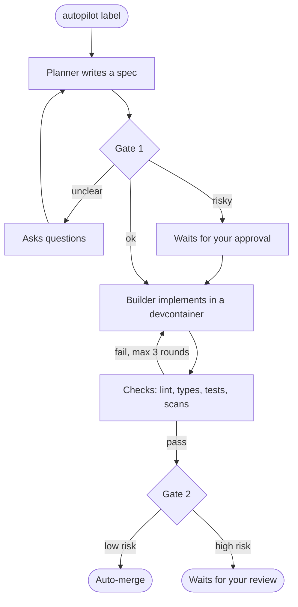

<p align="center">
  <picture>
    <source media="(prefers-color-scheme: dark)" srcset="assets/autopilot-wordmark-white.svg">
    
  </picture>
</p>

<p align="center">Runs coding agents on your own machine to work on GitHub issues.</p>

autopilot aims to stay small: one process, no server, no queue, no database. GitHub is the only interface and the only state. It is also agnostic: the agent harness, the models, the verification mode and the host are each one config field.

> [!WARNING]
> autopilot is in early development. Try it on a test repo first.

## Set up

### What you need

- **On your machine:** git, ssh, [mise](https://mise.jdx.dev/installing-mise.html), [gh](https://cli.github.com/) signed in to GitHub, and the [1Password CLI](https://developer.1password.com/docs/cli/get-started/) (`op`) signed in to your account. Setup prints the install command for a missing tool.
- **A Claude account** that can run `claude setup-token`. The agents use this token.
- **A host** that runs the jobs: a Linux machine that you can reach with SSH and sudo, with [Docker Engine](https://docs.docker.com/engine/install/) and its [rootless extras](https://docs.docker.com/engine/security/rootless/), and the [Compose plugin](https://docs.docker.com/compose/install/linux/), or a Mac with OrbStack, Colima or Docker Desktop. The host can also be the machine you work on.

### Steps

1. Install the client:

   ```sh
   curl -fsSL https://raw.githubusercontent.com/marcaureln/autopilot/main/install.sh | sh
   ```

2. Run the setup wizard:

   ```sh
   autopilot setup
   ```

   The wizard does these steps in this order. Each step checks what is in place and only does what is missing, so you can run it again at any time.

   1. **Tools.** It checks git, ssh, mise, op and gh.
   2. **1Password.** It creates the vault `autopilot` and a service account that can only read that vault. The host uses this account to read its secrets.
   3. **GitHub App.** Select "Create a new App". Your browser opens a GitHub page: click **Create GitHub App**. The private key goes to the vault. To use an App that you already have, give its App ID and the path of its `.pem` file.
   4. **Claude token.** The wizard runs `claude setup-token`, which signs you in to Claude in the browser and prints a token. Paste the token at the hidden prompt. It goes to the vault.
   5. **Host.** Give an SSH target such as `user@my-host`, or `local` for this machine. The wizard installs the latest release on the host and starts the service.
   6. **Owner and allowlist.** Your GitHub login is the owner: only owners can start a job. Then give the accounts, orgs or `owner/repo` entries that autopilot may work on. If the App is not installed there, the wizard opens the install page: select the repos, then click **Install**.
   7. **First repo.** The wizard runs `autopilot init` on a repo that you select. It opens an onboarding pull request (see [Onboarding](#onboarding)).
   8. **Alias.** It adds `ap` as a short name for `autopilot` to your shell.

3. Review and merge the onboarding pull request. Make sure that the check commands in `.github/autopilot.json` are correct. Until this pull request is merged, autopilot stops each issue in the repo.

4. Write your first issue. Ask for one small change, name the files, and give acceptance criteria. Then add the `autopilot` label:

   ```sh
   gh issue create --repo <owner>/<repo> --title "Add docs/labels.md" --body "Add docs/labels.md that lists the autopilot labels." --label autopilot
   ```

5. Follow the issue on GitHub. Within one minute, the host posts a claim comment, then a spec. Then it builds the change, runs the checks and opens a pull request. The labels tell you when you must act:

   | Label | What to do |
   | --- | --- |
   | `autopilot:working` | Nothing. Wait. |
   | `autopilot:needs-info` | Answer the questions of the spec in one comment. |
   | `autopilot:awaiting-approval` | Read the spec, then tick **Approve and build**. |
   | `autopilot:blocked` | Read the last comment, fix the cause, then remove the label to try again. |

   With `"merge": "manual"` (the default from `init`), you review and merge each pull request. To see what the host does, run `autopilot logs` with `AUTOPILOT_HOST` set to your host.

### Set up without prompts

To run it without prompts, put the answers in a file ([schema](schema/setup.schema.json)) and pass `--yes`:

```sh
autopilot setup --config setup.json --yes
```

```json
{
	"$schema": "https://raw.githubusercontent.com/marcaureln/autopilot/main/schema/setup.schema.json",
	"app_id": 123456,
	"host": "user@my-host",
	"allow": ["octocat/app"],
	"alias": "ap"
}
```

The unattended mode cannot create the GitHub App, because GitHub needs a click in the browser. Run `autopilot app create` first, or pass the `app_id` of an App whose private key is in 1Password. Secret values are never in the file: setup reads the Claude token from 1Password, or from `CLAUDE_CODE_OAUTH_TOKEN` the first time.

### Set up with a coding agent

Paste this prompt into Claude Code, Codex or another coding agent:

```text
Set up autopilot for me (https://github.com/marcaureln/autopilot).
Install its agent skill with `npx skills add marcaureln/autopilot`, then follow the "Set up" section of the skill.
Ask me before each step that needs my browser, my 1Password sign-in or a secret value.
Never read, print or write a secret value yourself.
```

The skill also teaches the agent to use autopilot day to day: write issues that autopilot can build, answer its questions, approve a spec and review its pull requests.

## How it works



Models propose and rules decide. The risk rules are deterministic, and a model can raise the risk but never lower it.

## Building blocks

Each block sits behind a config field or a small interface. Only the "Today" column is built.

| Block         | Today                          | Possible later              |
| ------------- | ------------------------------ | --------------------------- |
| Forge         | GitHub (App, labels, statuses) | GitLab, Forgejo             |
| Agent harness | Claude Code                    | OpenCode, Codex, pi         |
| Secrets       | 1Password CLI                  | OpenBao, age-encrypted file |

## Configuration

Each repo has a `.github/autopilot.json` ([full example](examples/autopilot.json)). The `$schema` field gives autocomplete and validation in VS Code.

```json
{
	"$schema": "https://raw.githubusercontent.com/marcaureln/autopilot/main/schema/autopilot.schema.json",
	"version": 1,
	"stack": ["node"],
	"merge": "auto"
}
```

### Onboarding

`autopilot init` onboards a repo in one pull request that you review and merge. Run it in a checkout of the repo, or pass `--repo <owner>/<repo>`. It needs `gh`, and Docker for the last two steps.

1. Detects the stack from the lockfiles (Node with npm, pnpm or yarn today) and writes `.github/autopilot.json` and `.devcontainer/` from the stack pack in `stacks/`. An existing config keeps its values.
2. Creates the five `autopilot` labels. With `AUTOPILOT_HOST` set, allows the repo on the host, which prints the App install page if the App is not installed there.
3. Runs an agent in a container (the Claude token comes from your 1Password) to correct the check commands and draft `AGENTS.md`. `--no-agent` skips it.
4. Runs the checks once on the default branch. Existing `lint` and `types` errors go to `.github/autopilot-baseline.json`, so only new errors fail.
5. Opens the pull request from your own account, with what to curate and the failing agent-readiness items.

### Secrets

A test that needs a key gets it from 1Password. Run these in a checkout of the repo, with your own 1Password sign-in:

```sh
autopilot secrets set STRIPE_KEY        # hidden prompt, or pipe the value on stdin
autopilot secrets set --from-env .env   # every key in the file
autopilot secrets list
autopilot secrets rm STRIPE_KEY
```

Each value goes to the `autopilot` vault, in one item per repo (`<owner>_<repo>`). The command adds the reference to `.github/autopilot.json`; commit it. A value is never a command argument, so it stays out of the shell history. A value must be on one line.

The host reads only the references to the repo's own item. It gives the values to the checks that run a command from `verify.commands` (such as `lint`, `types` and `test`), never to the scanners, the install step or the agent. A check that gets secrets shows only if it passed: autopilot keeps its output out of statuses, comments and the builder prompt.

The trust boundary is the same as in CI: whoever can change the code of a repo can read the secrets that the repo gets, for example from a test. Hiding the output only prevents accidents. Give a repo only test-mode or low-value keys.

## Install

The CLI on your machine is only a client. It installs for your user, without root. You need [mise](https://mise.jdx.dev/installing-mise.html), which installs the pinned Node.

```sh
curl -fsSL https://raw.githubusercontent.com/marcaureln/autopilot/main/install.sh | sh
autopilot self-update            # install the latest release, or --version vX.Y.Z
autopilot alias                  # add "alias ap=autopilot" to the rc file of your shell; --remove deletes it
```

The release goes to `~/.local/share/autopilot` and the command to `~/.local/bin/autopilot`.

## Hosts

A host runs `autopilot run` as a service and holds everything it needs: its `host.json`, the 1Password service account token, and a release from GitHub. At start, the host reads the App key and the Claude token with `op`. The client keeps no config and forwards each command to the host over SSH, like the Vault CLI with `VAULT_ADDR`. The host `local` is the machine you run the command on.

| Host | Service | Files | Logs |
| --- | --- | --- | --- |
| Linux | systemd, as the user `autopilot` with rootless Docker | `/etc/autopilot`, `/opt/autopilot` | journald |
| macOS | launchd agent of your user, with your OrbStack, Colima or Docker Desktop | `~/.autopilot` | `~/Library/Logs/autopilot` |

A macOS host runs while you are logged in, and stops while the Mac sleeps.

```sh
# Once per host: push the 1Password token, write host.json, install the latest release
autopilot host setup --host user@my-host --owner <login> --app-id <id>
autopilot host setup --host local --owner <login> --app-id <id>     # this machine

export AUTOPILOT_HOST=user@my-host
autopilot allow <owner>/<repo>   # opens the App install page if the App is not installed there
autopilot status
autopilot logs
autopilot audit --since 1d       # JSON audit events
autopilot update                 # install the latest release, or --version vX.Y.Z
```

Several hosts can share an allowlist. Before a host acts on an issue, it posts a claim comment. The oldest claim wins, and the other hosts skip the issue. To move an issue to another host, delete its claim comment.

## Agent skill

[`skills/autopilot`](skills/autopilot/SKILL.md) teaches a coding agent to set up autopilot and to use it: write issues that autopilot can build, answer its questions, approve a spec, review its pull requests, and retry a blocked issue. Install it with `npx skills add marcaureln/autopilot`, or copy the folder to the skills folder of your agent.

## Development

```sh
mise install && pnpm install
pnpm check               # types + lint + tests
node src/cli.ts run --once --config host.json   # a dev host; op reads secrets with your sign-in
```

Node runs the TypeScript files directly. There is no build step.
