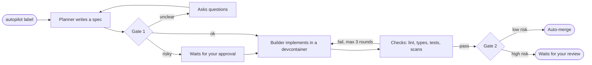

<p align="center">
  <picture>
    <source media="(prefers-color-scheme: dark)" srcset="assets/autopilot-wordmark-white.svg">
    
  </picture>
</p>

<p align="center"><b>A simple, self-hosted software factory.</b><br>Label a GitHub issue. Get a merged pull request.</p>

autopilot aims to stay small: one process, no server, no queue, no database. GitHub is the only interface and the only state. It is also agnostic: the agent harness, the models, the verification mode and the host are each one config field.

> [!WARNING]
> autopilot is in early development and does not work end to end yet. Do not use it on a repo you care about.

## How it works



Models propose and rules decide. The risk rules are deterministic, and a model can raise the risk but never lower it.

## Status

| Part | State |
| --- | --- |
| Config schema and loader | Done |
| Risk rules | Done |
| CLI, GitHub App auth, polling loop | Done |
| Host setup, planner, builder, checks, secrets, onboarding | Not started |

## Configuration

Each repo has a `.github/autopilot.json` ([full example](examples/autopilot.json)). The `$schema` field gives autocomplete and validation in VS Code.

```json
{
  "$schema": "https://raw.githubusercontent.com/marcaureln/autopilot/main/schema/autopilot.schema.json",
  "version": 1,
  "stack": ["node"],
  "merge": "auto"
}
```

## Development

```sh
mise install && pnpm install
pnpm check               # types + lint + tests
node src/cli.ts run --once
```

Node runs the TypeScript files directly. There is no build step.
