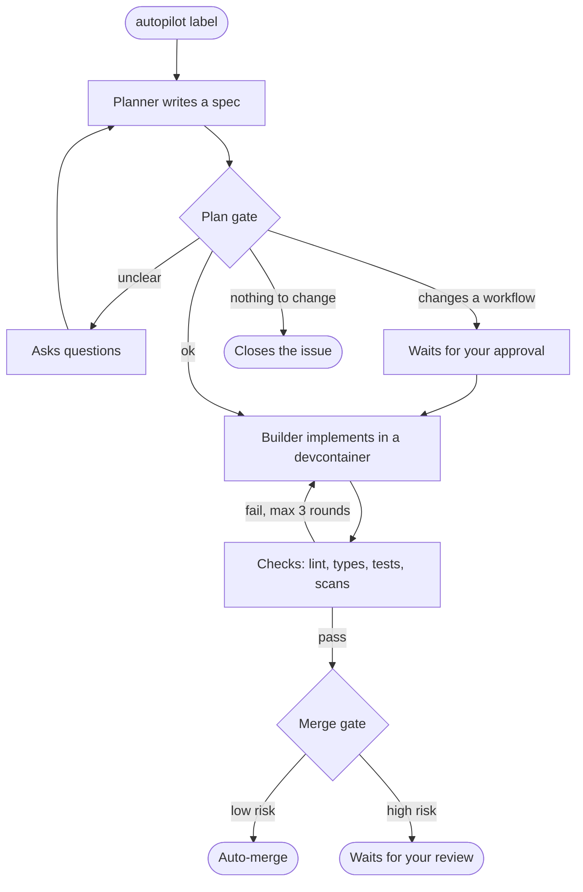

<p align="center">
  <picture>
    <source media="(prefers-color-scheme: dark)" srcset="assets/autopilot-wordmark-white.svg">
    
  </picture>
</p>

<p align="center">Turns issues into features, with coding agents on your own machine.</p>

autopilot is small. It is one process, with no server, no queue and no database. GitHub is the only interface, and it holds all the state.

> [!WARNING]
> autopilot is in early development. Try it on a test repo first.

## Set up

### Prerequisites

- **On your machine:** git, ssh, [mise](https://mise.jdx.dev/installing-mise.html) and [gh](https://cli.github.com/) signed in to GitHub.
- **A Claude account.** Run `claude setup-token` on any machine with Claude Code. The agents use the token that it prints.
- **A host** that runs the jobs: a Linux machine with SSH, sudo, [Docker Engine](https://docs.docker.com/engine/install/), its [rootless extras](https://docs.docker.com/engine/security/rootless/) and the [Compose plugin](https://docs.docker.com/compose/install/linux/), or a Mac with OrbStack, Colima or Docker Desktop. It can be the machine you work on.

### With a coding agent

Paste this prompt into Claude Code, Codex or another agent:

```text
Set up autopilot for me (https://github.com/marcaureln/autopilot).
Install its agent skill with `npx skills add marcaureln/autopilot`, then follow the "Set up" section of the skill.
Ask me before each step that needs my browser or a secret value.
Never read, print or write a secret value yourself.
```

The [skill](skills/autopilot/SKILL.md) also tells the agent how to write issues, answer questions, approve specs, review pull requests and debug a blocked issue.

### By hand

```sh
curl -fsSL https://marcaureln.com/autopilot/install.sh | sh
autopilot setup
```

The wizard creates a GitHub App, installs a host, pushes the App key and the Claude token to it, watches your account and onboards a first repo. It does only what is missing, so you can run it again at any time. For each step, and for a setup without prompts, see the [setup reference](skills/autopilot/references/setup.md).

## Use it

Write an issue that asks for one small change, with acceptance criteria. Add the `autopilot` label. The host claims it within one poll, writes a spec, builds the change, runs the checks and opens a pull request. The labels tell you when you must act:

| Label                         | What to do                                                                |
| ----------------------------- | ------------------------------------------------------------------------- |
| `autopilot:working`           | Nothing. Wait.                                                            |
| `autopilot:needs-info`        | Answer the questions of the spec in one comment.                          |
| `autopilot:awaiting-approval` | Read the spec, then tick **Approve and build**.                           |
| `autopilot:blocked`           | Read the last comment, fix the cause, then tick **Try again**.            |

A repo with no `.github/autopilot.json` is onboarded first: the host opens a "Set up autopilot" pull request with a dev container, the check commands and an `AGENTS.md`. Review it and merge it, then the issue continues. For an empty repo, write in the issue what to build, for example "A 2D platformer in Godot 4". `autopilot init` does the same from a checkout.

If something does not work, run `autopilot doctor`. It checks your machine, the host and the repo, and prints the command that fixes each problem. It changes nothing.

## How it works



Models propose and rules decide. The risk rules are deterministic, and a model can raise the risk but never lower it.

- **Environment.** The repo's own `.devcontainer/` runs the install, the checks and the agent, so any language works. The host refuses a dev container that reaches outside its container, and it cuts the network during the checks.
- **Checks.** The repo's commands and three scanners (Semgrep, Grype, TruffleHog) run on the host. With `"verify": { "mode": "ci" }`, the host waits for the repo's GitHub Actions jobs instead. [marcaureln/actions](https://github.com/marcaureln/actions) has the scanners as actions.
- **Secrets.** `autopilot secrets set <NAME>` keeps a value in a file on the host. Only the check commands get it, never the agent.
- **Hosts.** A host is a systemd service (Linux) or a launchd agent (macOS). The client keeps their names in a hosts file. Several hosts can watch the same repos.

Each repo is configured in `.github/autopilot.json` ([schema](schema/autopilot.schema.json)). Onboarding sets `"merge": "auto"`: the merge gate merges a low-risk pull request with no review. Set `"merge": "manual"` to review each pull request.

| Block         | Today                                                                                                  | Possible later |
| ------------- | ------------------------------------------------------------------------------------------------------ | -------------- |
| Forge         | [GitHub](src/core/github.ts)                                                                           | GitLab         |
| Agent harness | [Claude Code](src/harness/claude.ts) or [OpenCode](src/harness/opencode.ts), per role                  | Codex, pi      |
| Environment   | [The repo's dev container](src/core/environment.ts), with [guardrails](src/core/devcontainer.ts)       | -              |
| Checks        | [Commands and scanners](src/core/checks.ts), on the host or in CI                                      | -              |
| Risk          | [Rules](src/core/risk.ts) and [gates](src/core/gate.ts)                                                | -              |
| Secrets       | [Files on the host](src/core/secrets.ts), or the [1Password CLI](src/commands/secrets.ts)              | -              |

## Out of scope

autopilot does one job. It does not do these things, on purpose:

- **Network control.** It does not filter what the agents reach on the internet. Set that up on the host.
- **Learning by itself.** It does not change its own prompts. Improve your skills and your `AGENTS.md`.
- **A database.** GitHub holds the state.
- **A UI.** You work in GitHub: issues, labels, comments and pull requests.
- **Project management.** No boards, priorities or roadmaps. autopilot works on each labeled issue. Plan in GitHub Projects or in the tool you like.
- **Project templates.** Each repo brings its own dev container.
- **A hosted service.** It runs on your machines, with your accounts.

## Development

```sh
mise install && pnpm install
pnpm check               # types + lint + tests
```

`pnpm lint:unused` (knip) and `pnpm lint:deps` (dependency-cruiser) look for dead code and import cycles. They run on your machine only, not in CI.

Node runs the TypeScript files directly. There is no build step.

## References

- [Claude Code devcontainer](https://github.com/anthropics/claude-code/tree/main/.devcontainer), [Dev Container CLI](https://github.com/devcontainers/cli) and the [Dev Container specification](https://containers.dev/).
- [pstack](https://github.com/michael-denyer/pstack-claude) and [superpowers](https://github.com/obra/superpowers): skills for the planner and the builder.
