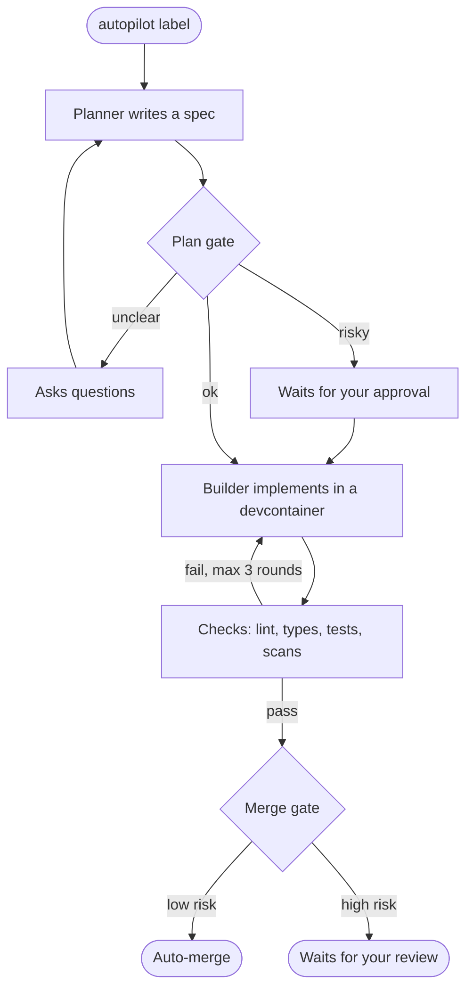

<p align="center">
  <picture>
    <source media="(prefers-color-scheme: dark)" srcset="assets/autopilot-wordmark-white.svg">
    
  </picture>
</p>

<p align="center">Turns issues into features, with coding agents on your own machine.</p>

autopilot is small. It is one process, with no server, no queue and no database. GitHub is the only interface, and it holds all the state. The agent harness, the models, the verification mode and the host are each one config field.

> [!WARNING]
> autopilot is in early development. Try it on a test repo first.

## Set up

### What you need

- **On your machine:** git, ssh, [mise](https://mise.jdx.dev/installing-mise.html) and [gh](https://cli.github.com/) signed in to GitHub. Setup prints the install command for a missing tool. `autopilot init` also needs Docker with the Compose plugin.
- **A Claude account.** Run `claude setup-token` on any machine with Claude Code. It prints a token, which the agents use.
- **Optional: 1Password.** By default, the host keeps its secrets in files. To keep them in 1Password, you also need the [1Password CLI](https://developer.1password.com/docs/cli/get-started/) (`op`) signed in to your account. Pass `--backend op` to the wizard.
- **A host** that runs the jobs. It is a Linux machine that you can reach with SSH and sudo, with [Docker Engine](https://docs.docker.com/engine/install/), its [rootless extras](https://docs.docker.com/engine/security/rootless/) and the [Compose plugin](https://docs.docker.com/compose/install/linux/). It can also be a Mac with OrbStack, Colima or Docker Desktop. The host can be the machine you work on.

### Steps

1. Install the client. It installs for your user, without root, in `~/.local/share/autopilot` and `~/.local/bin/autopilot`. Update it later with `autopilot self-update`.

   ```sh
   curl -fsSL https://raw.githubusercontent.com/marcaureln/autopilot/main/install.sh | sh
   ```

2. Run the setup wizard:

   ```sh
   autopilot setup
   ```

   The wizard does these steps in this order. Each step checks what is in place and does only what is missing, so you can run the wizard again at any time.
   1. **Tools.** It checks git, ssh, mise and gh.
   2. **GitHub App.** Select "Create a new App". Your browser opens a GitHub page. Click **Create GitHub App**. The wizard saves the private key in `~/.config/autopilot/app-key.pem` (mode 600). To use an App that you already have, give its App ID. The host step then asks for the path of its `.pem` file.
   3. **Host.** With no `--host`, the wizard uses the default host of the hosts file, if there is one. If not, give an SSH target such as `user@my-host`, or `local` for this machine. The wizard saves the host under the host part of its SSH target. To choose another name, pass `--name <name>`. The wizard installs the latest release on the host. Then it pushes the App key and the Claude token to files on the host, and starts the service. For the token, it runs `claude setup-token` if Claude Code is on this machine. If not, run `claude setup-token` on any machine with Claude Code. Paste the token at the hidden prompt. The wizard saves the host in the hosts file (see [Hosts](#hosts)). If it is your first host, it becomes the default host, and the next commands act on it.
   4. **Owner and watched repos.** Your GitHub login becomes the owner. Only owners can start a job. Then give the accounts, orgs or `owner/repo` entries that the host watches. The wizard proposes your login, so the host watches all your repos. If the App is not installed there, the wizard opens the install page. Select **All repositories**, then click **Install**.
   5. **First repo.** The wizard runs `autopilot init` on a repo that you select. It opens an onboarding pull request (see [Onboarding](#onboarding)).
   6. **Alias.** It adds `ap` as a short name for `autopilot` to your shell.

   With `--backend op`, the wizard also checks `op`. It creates the vault `autopilot` and a service account that can only read that vault. It saves the App key and the Claude token in the vault, and the host reads them with the service account.

3. Review and merge the onboarding pull request. Make sure that the check commands in `.github/autopilot.json` are correct. Until you merge this pull request, each issue in the repo waits.

4. Write your first issue. Ask for one small change, name the files, and give acceptance criteria. Then add the `autopilot` label:

   ```sh
   gh issue create --repo <owner>/<repo> --title "Add docs/labels.md" --body "Add docs/labels.md that lists the autopilot labels." --label autopilot
   ```

5. Follow the issue on GitHub. Within one minute, the host posts a claim comment, then a spec. Then it builds the change, runs the checks and opens a pull request. The labels tell you when you must act:

   | Label                         | What to do                                                                |
   | ----------------------------- | ------------------------------------------------------------------------- |
   | `autopilot:working`           | Nothing. Wait.                                                            |
   | `autopilot:needs-info`        | Answer the questions of the spec in one comment.                          |
   | `autopilot:awaiting-approval` | Read the spec, then tick **Approve and build**.                           |
   | `autopilot:blocked`           | Read the last comment, fix the cause, then remove the label to try again. |

   With `"merge": "manual"` (the default from `init`), you review and merge each pull request. To see what the host does, run `autopilot logs`.

### Set up without prompts

To run setup without prompts, put the answers in a file ([schema](schema/setup.schema.json)) and pass `--yes`:

```sh
autopilot setup --config setup.json --yes
```

```json
{
	"$schema": "https://raw.githubusercontent.com/marcaureln/autopilot/main/schema/setup.schema.json",
	"app_id": 123456,
	"host": "user@my-host",
	"allow": ["octocat/app"],
	"alias": "ap"
}
```

GitHub needs a click in the browser to create an App, so run `autopilot app create` first. It saves the key in `~/.config/autopilot/app-key.pem`, where setup finds it. For an App that you already have, also set `app_key` to the path of its `.pem` file. Give the Claude token in `CLAUDE_CODE_OAUTH_TOKEN`. The file never holds a secret value. With `"backend": "op"`, the key and the token must be in 1Password.

### Set up with a coding agent

Paste this prompt into Claude Code, Codex or another coding agent:

```text
Set up autopilot for me (https://github.com/marcaureln/autopilot).
Install its agent skill with `npx skills add marcaureln/autopilot`, then follow the "Set up" section of the skill.
Ask me before each step that needs my browser or a secret value.
Never read, print or write a secret value yourself.
```

The [skill](skills/autopilot/SKILL.md) also tells the agent how to use autopilot. It can write issues that autopilot can build, answer its questions, approve a spec, review its pull requests and debug a blocked issue.

## How it works



Models propose and rules decide. The risk rules are deterministic, and a model can raise the risk but never lower it.

## Building blocks

autopilot has a small core. Each block is behind a config field or a small interface. Only the "Today" column exists in the code.

| Block         | Today                                                                                  | Possible later       |
| ------------- | -------------------------------------------------------------------------------------- | -------------------- |
| Forge         | [GitHub](src/core/github.ts)                                                           | GitLab               |
| Agent harness | [Claude Code](src/harness/claude.ts) ([image](docker/claude)) or [OpenCode](src/harness/opencode.ts) ([image](docker/opencode)), per role | Codex, pi            |
| Environment   | The repo's dev container ([environment](src/core/environment.ts), [guardrails](src/core/devcontainer.ts)) | -                    |
| Checks        | [Commands and scanners](src/core/checks.ts), on the host or in the repo's own CI       | -                    |
| Risk          | [Rules](src/core/risk.ts) and [gates](src/core/gate.ts)                                | -                    |
| Secrets       | [Files on the host](src/core/secrets.ts), or the [1Password CLI](src/commands/secrets.ts) | -                    |

## Out of scope

autopilot does one job. It turns issues into features. It does not do these things, on purpose:

- **Network control.** autopilot does not filter what the agents reach on the internet. If you need that, set it up on the host.
- **Learning by itself.** autopilot does not change its own prompts. To get better results, improve your skills and your `AGENTS.md`.
- **A database.** GitHub holds the state. A host keeps only its config and its secrets. Your machine keeps only the App key that `app create` saves.
- **A UI.** You work in GitHub: issues, labels, comments and pull requests.
- **Project templates.** Each repo brings its own dev container, so autopilot works with any language or engine.
- **A hosted service.** It runs on your machines, with your accounts.

## Configuration

Each repo has a `.github/autopilot.json`, which `init` writes. The [schema](schema/autopilot.schema.json) describes each field and its default, and the `$schema` field gives autocomplete and validation in VS Code.

```json
{
	"$schema": "https://raw.githubusercontent.com/marcaureln/autopilot/main/schema/autopilot.schema.json",
	"version": 1,
	"merge": "auto"
}
```

### Checks in your own CI

The checks are the repo's own commands and the scanners. `verify.mode` says where they run. By default (`host`), the autopilot host runs them. With `"verify": { "mode": "ci", "required": ["sast", "deps-scan", "secrets-scan", "test"] }`, the host runs nothing. It waits for the repo's own CI on the head commit of the pull request. Each name in `required` is the name of a GitHub Actions job. Only a success passes, so a skipped job blocks the merge. Results from other Apps or from commit statuses do not count, because anyone with write access can post them. When a check fails, the builder gets its output and annotations for a fix round. [marcaureln/actions](https://github.com/marcaureln/actions) has the `sast`, `deps-scan` and `secrets-scan` scanners as composite actions.

### Onboarding

Onboarding adds autopilot to a repo in one pull request that you review and merge. The host never merges it. You can start it in two ways:

- **With an issue.** Add the `autopilot` label to an issue in a watched repo that has no `.github/autopilot.json`. The host does the onboarding with the App and its own agent token, so you need no laptop. The issue tells the onboarding agent what the project is. For an empty repo, write what to build, for example "A 2D platformer in Godot 4". The host opens the pull request "Set up autopilot" and comments on the issue with its link. The issue waits until you merge the pull request, then its work starts. If you close the pull request without a merge, the host blocks the issue.
- **With `autopilot init`.** Run it in a checkout of the repo, or pass `--repo <owner>/<repo>`. It needs `gh` and Docker with the Compose plugin.

The repo's own `.devcontainer/` is the environment of every job: the install, the checks and the builder run in it, with its compose services, so any language works. The onboarding:

1. Runs an agent. The agent writes `.devcontainer/` if the repo has none, from [Anthropic's dev container](https://github.com/anthropics/claude-code/tree/main/.devcontainer) without its firewall. It also sets the check commands and drafts `AGENTS.md`. An existing `.devcontainer/` or config keeps its values.
2. Starts the dev container, cuts its network and runs each check once. Existing `lint` and `types` errors go to `.github/autopilot-baseline.json`, so only new errors fail.
3. Creates the `autopilot` labels and opens the pull request: from your account with `init`, from the App with an issue.

With `init`, `--skill <source>` (repeatable) gives the agents a skill. `--notes <file>` adds your own instructions to the onboarding agent.

The host refuses a `.devcontainer/` that reaches outside its container: host commands, `runArgs`, privileges, host mounts and namespaces, published ports, `${localEnv:...}`, and images without an exact version tag. It adds its own memory, CPU and process caps, and it cuts the outside network during the checks.

### Secrets

A test that needs a key gets it from the repo's secrets. By default, autopilot keeps them in one env file per repo on the host. Run these in a checkout of the repo. They act on the default host, or on the host of `--host`:

```sh
autopilot secrets set STRIPE_KEY        # hidden prompt, or pipe the value on stdin
autopilot secrets set --from-env .env   # every key in the file
autopilot secrets list
autopilot secrets rm STRIPE_KEY
```

The file is `secrets/repos/<owner>_<repo>.env` in `/etc/autopilot` on Linux, or in `~/.autopilot` on macOS. A value is never a command argument, so it stays out of the shell history. A value must be on one line.

The default backend is `env` for `setup`, `init`, `app create`, `hosts add` and `secrets`. To keep using 1Password, pass `--backend op` to each of these commands.

With `--backend op`, the values go to 1Password, with your own sign-in. Each repo gets one item (`<owner>_<repo>`) in the `autopilot` vault. The command adds the reference to `.github/autopilot.json`. Commit that change. A reference in the config wins over a value of the same name in the host's file.

The host gives the values only to the checks that run a command from `verify.commands`. The scanners, the install step and the agent never get them. For such a check, the host shows only whether it passed. As in CI, a person who can change the code of a repo can read its secrets, for example from a test. Give a repo only test-mode or low-value keys.

## Hosts

A host runs autopilot as a service. It holds its `host.json`, its secrets and a release. At start, it reads the App key and the Claude token that `host.json` names. By default, these are the files `app-key.pem` and `claude-token` in the secrets folder: `/etc/autopilot/secrets` on Linux (owner root, group `autopilot`, mode 640), or `~/.autopilot/secrets` on macOS (mode 600). An `op://` reference makes the host read the value with `op` and a 1Password service account token.

The client keeps one file: `~/.config/autopilot/hosts.json`, or `$XDG_CONFIG_HOME/autopilot/hosts.json` ([schema](schema/hosts.schema.json)). It gives a name and an SSH target to each host. It holds no secret. `autopilot app create` saves `app-key.pem` in the same folder. The client forwards each host command to the host over SSH. The target `local` is the machine that you run the command on. A command finds its host in this order:

1. `--host <value>`.
2. `AUTOPILOT_HOST`.
3. The default host of the hosts file.

If the value is the name of a host in the file, the command uses the target of that host. If not, the command uses the value as an SSH target, or as `local`. autopilot gives the target to `ssh` as it is, so a `Host` alias of `~/.ssh/config` works. A name in the hosts file wins over a `Host` alias of the same name.

A command that the client forwards never reads the hosts file on the host: the client sends `--host=`, and under `sudo` the host skips the file. A client from before this change sends no `--host=` to a macOS host, so a macOS host that also has a hosts file forwards the command again: update the client. A command that you type on a host that has a hosts file acts on its default host. Pass `--host local` to act on the host itself.

| Host  | Service                                                                  | Files                              | Logs                       |
| ----- | ------------------------------------------------------------------------ | ---------------------------------- | -------------------------- |
| Linux | systemd, as the user `autopilot` with rootless Docker                    | `/etc/autopilot`, `/opt/autopilot` | journald                   |
| macOS | launchd agent of your user, with your OrbStack, Colima or Docker Desktop | `~/.autopilot`                     | `~/Library/Logs/autopilot` |

A macOS host runs while you are logged in, and stops while the Mac sleeps.

```sh
# Once per host: write host.json, install the latest release, push the App key and the Claude token,
# then save the host in the hosts file. The first host that you add becomes the default host.
# The key comes from --app-key, or from ~/.config/autopilot/app-key.pem. The token comes from
# CLAUDE_CODE_OAUTH_TOKEN, or from a hidden prompt. Run it again to repair or upgrade: it keeps the
# secrets the host has. To replace a secret, remove its file on the host, then run it again.
autopilot hosts add pi user@my-host --owner <login> --app-id <id> --app-key app.pem
autopilot hosts add mac local --owner <login> --app-id <id>     # this machine

autopilot hosts                  # the hosts, and which one is the default
autopilot hosts default mac      # the host of the commands that have no --host
autopilot hosts rm mac           # remove it from the hosts file. It does not uninstall the host

autopilot watch <owner>/<repo>   # opens the App install page if the App is not installed there
autopilot watch                  # what the host watches; --remove <entry> stops watching it
autopilot status
autopilot logs                   # --audit for the JSON audit events
autopilot start                  # or stop
autopilot update                 # install the latest release, or --version vX.Y.Z
autopilot --host pi status       # act on a host that is not the default
```

`autopilot host setup --host <target>` still works. It does the same as `hosts add`. Without `--host`, it acts on the default host. The name is `--name`, else the host part of the SSH target, or the short hostname for `local`. It stops before it changes anything if that name is not valid, for example for `user@[fe80::1]`: pass `--name`. `autopilot setup` does the same. Use `hosts add` instead, because it replaces `host setup`.

To replace a host secret, for example a wrong Claude token, remove its file in the secrets folder: `/etc/autopilot/secrets` on Linux, or `~/.autopilot/secrets` on macOS. Then run the same `autopilot hosts add` command again. It asks only for the secret that the host lacks, writes it, and restarts the service.

A host works on one issue at a time by default. To run more at once, set `concurrency` in its `host.json`. Each issue gets its own containers and `limits`, so size it to the host's memory and to the rate limits of your Claude plan.

Several hosts can watch the same repos. The oldest claim comment on an issue wins. To move an issue to another host, delete its claim comment.

## Development

```sh
mise install && pnpm install
pnpm check               # types + lint + tests
node src/cli.ts start --foreground --once --config host.json   # one loop on a dev host, with the secrets that host.json names
```

Node runs the TypeScript files directly. There is no build step.

## References

autopilot builds on these projects and ideas:

- [Claude Code devcontainer](https://github.com/anthropics/claude-code/tree/main/.devcontainer): Anthropic's reference devcontainer for Claude Code.
- [Dev Container CLI](https://github.com/devcontainers/cli) and the [Dev Container specification](https://containers.dev/).
- [pstack](https://github.com/michael-denyer/pstack-claude): poteto's agent workflows, used as skills for the planner and the builder.
- [superpowers](https://github.com/obra/superpowers): obra's skills for test-driven development and systematic debugging.
